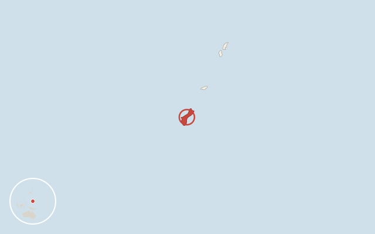

---
id    = "751fb8d1-18c8-5ac0-a443-fd0643c68021"
model = "Basic"
tags  = ["oceania", "country"]
---

## Front

<b>Hagåtña</b> is the capital of which country or territory?

## Back

<b>Guam</b>

## Extra

Unincorporated territory of the United States.

<a href="https://en.wikipedia.org/wiki/Guam">Guam on Wikipedia</a> <a href="https://en.wikipedia.org/wiki/Hag%C3%A5t%C3%B1a,_Guam">Hagåtña, Guam on Wikipedia</a>
