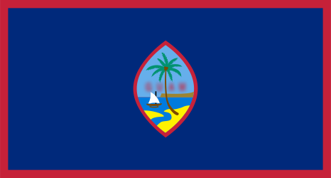
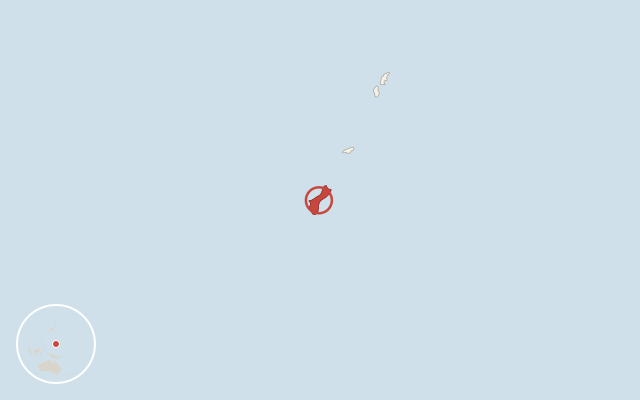

---
id    = "33b794c3-6b50-57ab-ac63-c24f1b6e5020"
model = "Basic"
tags  = ["oceania", "flag"]
---

## Front

Whose flag is this?

## Back

<b>Guam</b>

## Extra

Unincorporated territory of the United States.

<a href="https://en.wikipedia.org/wiki/Flag_of_Guam">Flag of Guam on Wikipedia</a> <a href="https://en.wikipedia.org/wiki/Guam">Guam on Wikipedia</a>
