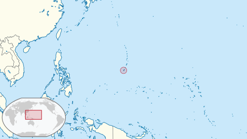
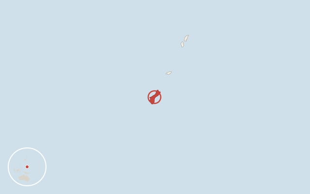
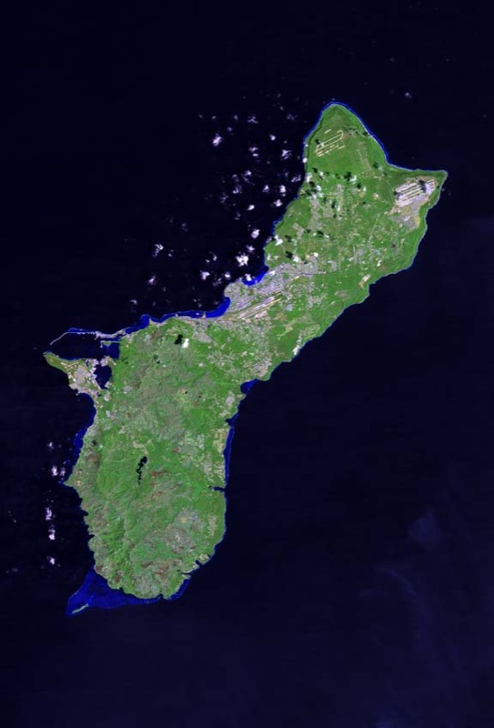

---
id    = "c892793f-e7ac-5687-b89f-fd41f5fe2d4a"
model = "Basic"
tags  = ["oceania", "map"]
---

## Front

What is highlighted on this map?

## Back

<b>Guam</b>

## Extra

<i>Photo: http://www.terraprints.com, CC BY 2.5, via Wikimedia Commons</i>

Largest and southernmost of the Mariana Islands Highest point: Mount Lamlam

Guam is the closest land mass to the Mariana Trench, the deep subduction zone that runs east of the Marianas.

Unincorporated territory of the United States.

<a href="https://en.wikipedia.org/wiki/Guam">Guam on Wikipedia</a>
