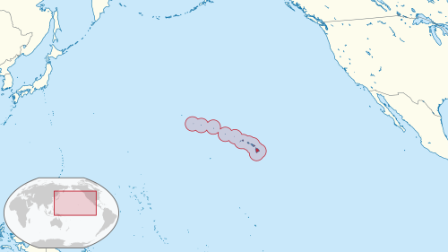

---
id    = "d7692366-1437-51c1-b270-55236e7a2b4c"
model = "Basic"
tags  = ["oceania", "map"]
---

## Front

What is highlighted on this map?

## Back

<b>Hawaii</b>

## Extra

28,311 km² of land About 1.46 million people (2020)

137 volcanic islands spread over 2,400 km. The eight main ones run from northwest to southeast: Niʻihau, Kauaʻi, Oʻahu, Molokaʻi, Lānaʻi, Kahoʻolawe, Maui and Hawaiʻi, the Big Island.

State of the United States.

<a href="https://en.wikipedia.org/wiki/Hawaii">Hawaii on Wikipedia</a>
