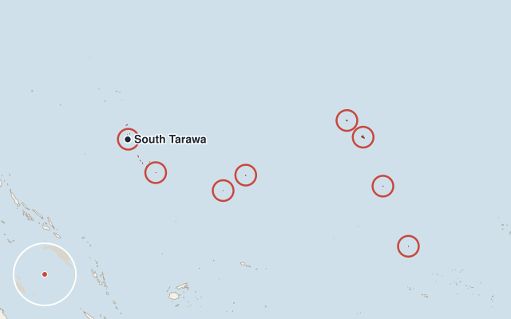
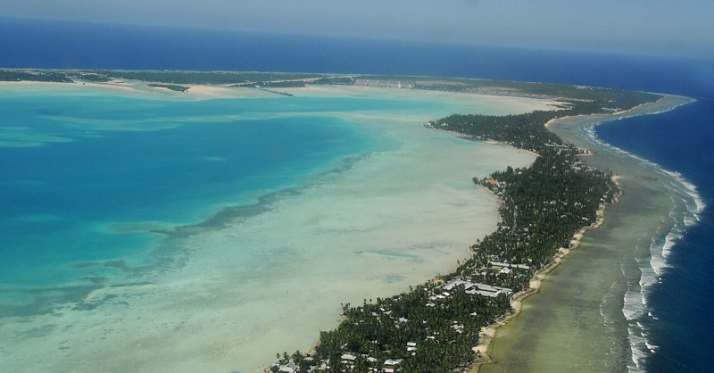

---
id    = "4ac23bef-3f71-5c6b-99f5-16ca8a1f9803"
model = "Basic"
tags  = ["oceania", "sovereign_state", "capital"]
---

## Front

What is the capital of <b>Kiribati</b>?

## Back

<b>South Tarawa</b>

## Extra

<i>Photo: Photo taken by Government of Kiribati employee in the course of their work, CC BY 3.0, via Wikimedia Commons</i>

About 63,000 people (2020) 3 m above sea level

A string of small islets joined by one main road, from Betio in the west to Bonriki and Tanaea in the northeast. It holds most of the government and more than half of Kiribati's people.

<a href="https://en.wikipedia.org/wiki/South_Tarawa">South Tarawa on Wikipedia</a> <a href="https://en.wikipedia.org/wiki/Kiribati">Kiribati on Wikipedia</a>
