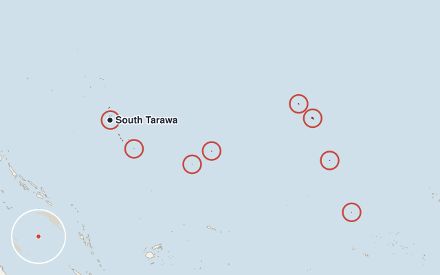

---
id    = "5270c887-5426-5d30-91fc-0dc5a5bfd076"
model = "Basic"
tags  = ["oceania", "sovereign_state", "country"]
---

## Front

<b>South Tarawa</b> is the capital of which country or territory?

## Back

<b>Kiribati</b>

## Extra

About 134,500 people (2024) 811 km² of land spread over 3.4 million km² of ocean

The International Date Line swings far east around it, which puts Kiribati's easternmost islands in UTC+14, the most advanced time zone on Earth.

<a href="https://en.wikipedia.org/wiki/Kiribati">Kiribati on Wikipedia</a> <a href="https://en.wikipedia.org/wiki/South_Tarawa">South Tarawa on Wikipedia</a>
