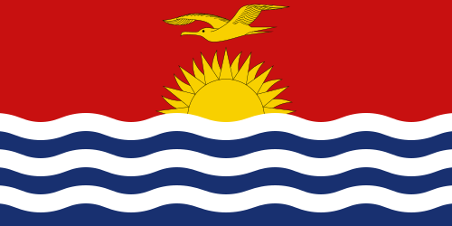
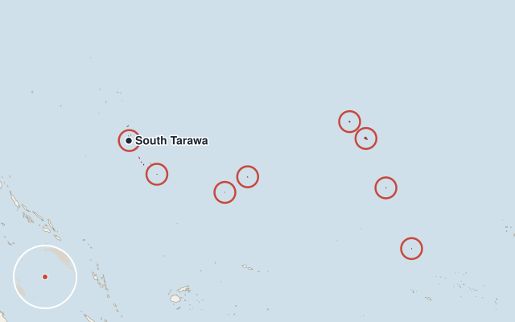

---
id    = "5c723bb9-8baa-5bae-a8bc-473845734633"
model = "Basic"
tags  = ["oceania", "sovereign_state", "flag"]
---

## Front

Whose flag is this?

## Back

<b>Kiribati</b>

## Extra

Derived from a badge designed by Sir Arthur Grimble in 1931, granted in 1937

A gold frigatebird flies over a rising sun, a sign of the equator. Three wavy white stripes stand for the Gilbert, Phoenix and Line Islands, and the sun's 17 rays for the 16 Gilbert Islands and Banaba.

<a href="https://en.wikipedia.org/wiki/Flag_of_Kiribati">Flag of Kiribati on Wikipedia</a> <a href="https://en.wikipedia.org/wiki/Kiribati">Kiribati on Wikipedia</a>
