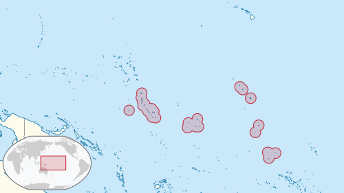
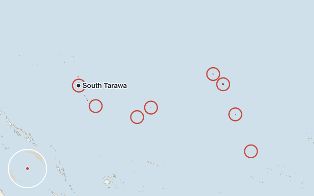

---
id    = "737b7f9f-2b24-51de-9ff0-168b926b9eed"
model = "Basic"
tags  = ["oceania", "sovereign_state", "map"]
---

## Front

What is highlighted on this map?

## Back

<b>Kiribati</b>

## Extra

32 atolls and other islands, plus the raised coral island Banaba

The islands run from Banaba in the west to Kiritimati in the east, across three groups: the Gilbert, Phoenix and Line Islands.

<a href="https://en.wikipedia.org/wiki/Kiribati">Kiribati on Wikipedia</a>
