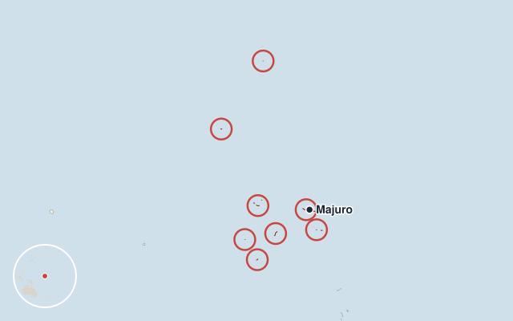

---
id    = "844133c0-3b47-5b71-b4b3-c10d6dceb82a"
model = "Basic"
tags  = ["oceania", "sovereign_state", "capital"]
---

## Front

What is the capital of <b>Marshall Islands</b>?

## Back

<b>Majuro</b>

## Extra

About 30,000 people (2008) A coral atoll of 64 islands around a 295 km² lagoon

Became the capital after the Marshall Islands broke away from the Federated States of Micronesia in 1978, taking over from Jaluit. Germany had annexed the atoll in 1885.

<a href="https://en.wikipedia.org/wiki/Majuro">Majuro on Wikipedia</a> <a href="https://en.wikipedia.org/wiki/Marshall_Islands">Marshall Islands on Wikipedia</a>
