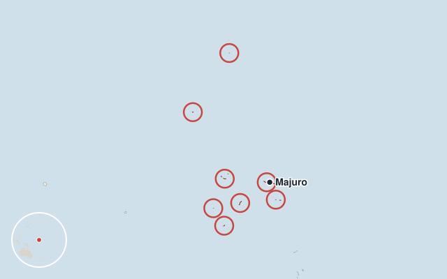

---
id    = "085ba2d4-7059-5c88-93f3-63c7150184fe"
model = "Basic"
tags  = ["oceania", "sovereign_state", "country"]
---

## Front

<b>Majuro</b> is the capital of which country or territory?

## Back

<b>Marshall Islands</b>

## Extra

<a href="https://en.wikipedia.org/wiki/Marshall_Islands">Marshall Islands on Wikipedia</a> <a href="https://en.wikipedia.org/wiki/Majuro">Majuro on Wikipedia</a>
