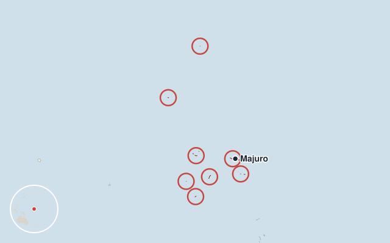

---
id    = "e556321c-e402-5ef6-990c-793241e579c2"
model = "Basic"
tags  = ["oceania", "sovereign_state", "flag"]
---

## Front

Whose flag is this?

## Back

<b>Marshall Islands</b>

## Extra

<a href="https://en.wikipedia.org/wiki/Flag_of_the_Marshall_Islands">Flag of the Marshall Islands on Wikipedia</a> <a href="https://en.wikipedia.org/wiki/Marshall_Islands">Marshall Islands on Wikipedia</a>
