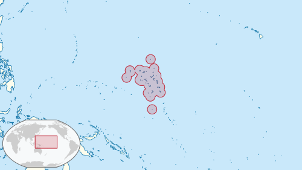
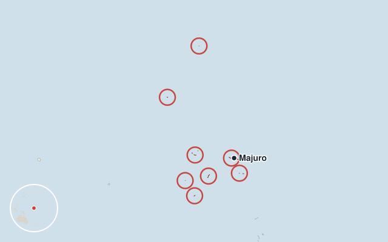

---
id    = "5a3cbb04-549d-56ae-886b-a81bae3cb1fd"
model = "Basic"
tags  = ["oceania", "sovereign_state", "map"]
---

## Front

What is highlighted on this map?

## Back

<b>Marshall Islands</b>

## Extra

<a href="https://en.wikipedia.org/wiki/Marshall_Islands">Marshall Islands on Wikipedia</a>
