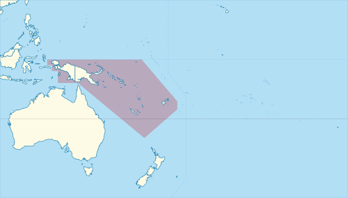

---
id    = "2b7821ba-e7b0-541f-96e7-87c9a5abdd6d"
model = "Basic"
tags  = ["oceania", "map"]
---

## Front

What is highlighted on this map?

## Back

<b>Melanesia</b>

## Extra

About 11.1 million people (2020) Four independent countries: Fiji, Vanuatu, Solomon Islands and Papua New Guinea

The name was first used in 1832 by the French navigator Jules Dumont d'Urville, who also coined Micronesia. It comes from Greek for the Black Islands.

Subregion of Oceania, which includes Vanuatu, the Solomon Islands, Fiji, and Papua New Guinea.

<a href="https://en.wikipedia.org/wiki/Melanesia">Melanesia on Wikipedia</a>
