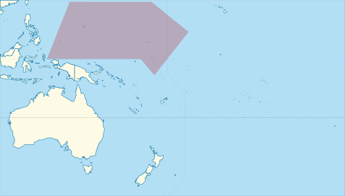

---
id    = "178de9d9-5be6-53ce-94fc-a068782f3132"
model = "Basic"
tags  = ["oceania", "map"]
---

## Front

What is highlighted on this map?

## Back

<b>Micronesia</b>

## Extra

Subregion of Oceania comprising thousands of small islands in the western Pacific Ocean.

<a href="https://en.wikipedia.org/wiki/Federated_States_of_Micronesia">Federated States of Micronesia on Wikipedia</a>
