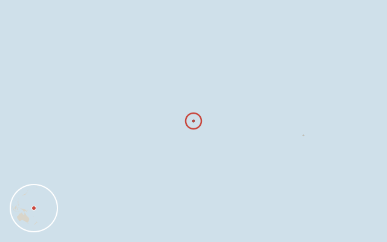

---
id    = "52cd09cd-82db-55de-b692-57a8c761a2c8"
model = "Basic"
tags  = ["oceania", "sovereign_state", "capital"]
---

## Front

What is the capital of <b>Nauru</b>?

## Back

<b>Yaren</b>

## Extra

<i>Photo: User:CdaMVvWgS, Public domain, via Wikimedia Commons</i>

747 people in the district (2011) 25 m above sea level on the south coast

Nauru has no official capital, and the UN accepts Yaren as its main district. Its old name, Makwa, refers to Moqua Well, an underground lake that was the main source of drinking water.

Nauru has no official capital; the Yaren District is the de facto capital.

<a href="https://en.wikipedia.org/wiki/Yaren">Yaren on Wikipedia</a> <a href="https://en.wikipedia.org/wiki/Nauru">Nauru on Wikipedia</a>
