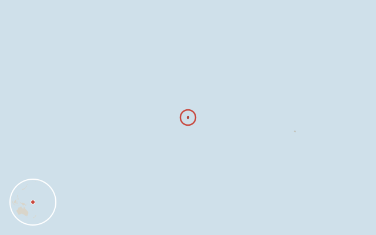

---
id    = "d4652a54-c2b1-56cd-8553-8feb970825ff"
model = "Basic"
tags  = ["oceania", "sovereign_state", "country"]
---

## Front

<b>Yaren</b> is the capital of which country or territory?

## Back

<b>Nauru</b>

## Extra

About 13,650 people (2017) on 21 km² Nearest neighbour is Banaba, in Kiribati, about 300 km east

The third-smallest country in the world, and the smallest member of the Commonwealth of Nations by both area and population.

Nauru has no official capital; the Yaren District is the de facto capital.

<a href="https://en.wikipedia.org/wiki/Nauru">Nauru on Wikipedia</a> <a href="https://en.wikipedia.org/wiki/Yaren">Yaren on Wikipedia</a>
