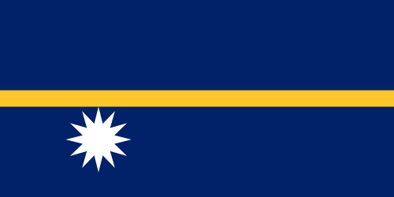
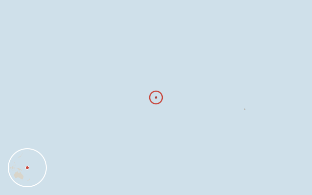

---
id    = "17f54351-a607-58fa-9130-5c033fa0781b"
model = "Basic"
tags  = ["oceania", "sovereign_state", "flag"]
---

## Front

Whose flag is this?

## Back

<b>Nauru</b>

## Extra

Similar flags: Curaçao (two stars in top-left corner)

<a href="https://en.wikipedia.org/wiki/Flag_of_Nauru">Flag of Nauru on Wikipedia</a> <a href="https://en.wikipedia.org/wiki/Nauru">Nauru on Wikipedia</a>
