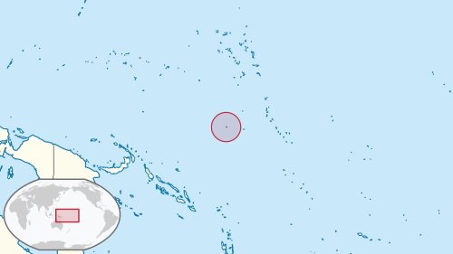
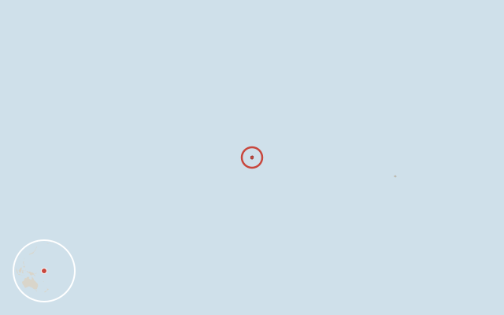
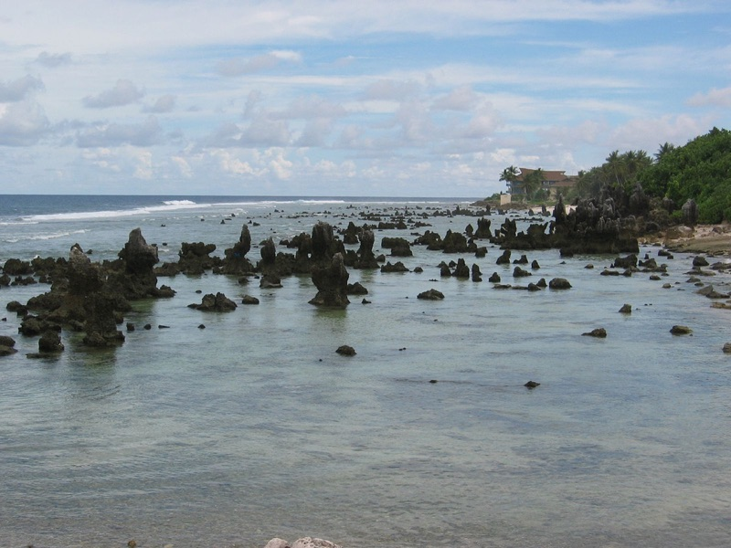

---
id    = "e6349f3b-68d2-5e5e-aa2a-c795aebedd63"
model = "Basic"
tags  = ["oceania", "sovereign_state", "map"]
---

## Front

What is highlighted on this map?

## Back

<b>Nauru</b>

## Extra

<i>Photo: d-online, CC BY-SA 2.0, via Wikimedia Commons</i>

21.2 km² of land

A phosphate-rock island with rich deposits near the surface. Most of its interior was strip-mined for about a century starting in 1900.

<a href="https://en.wikipedia.org/wiki/Nauru">Nauru on Wikipedia</a>
