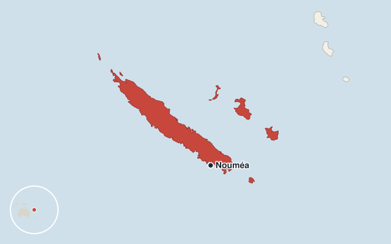

---
id    = "7022a893-a2b4-55b5-bb74-65cd887f7c07"
model = "Basic"
tags  = ["oceania", "capital"]
---

## Front

What is the capital of <b>New Caledonia</b>?

## Back

<b>Nouméa</b>

## Extra

Overseas territory of France.

<a href="https://en.wikipedia.org/wiki/Noum%C3%A9a">Nouméa on Wikipedia</a> <a href="https://en.wikipedia.org/wiki/New_Caledonia">New Caledonia on Wikipedia</a>
