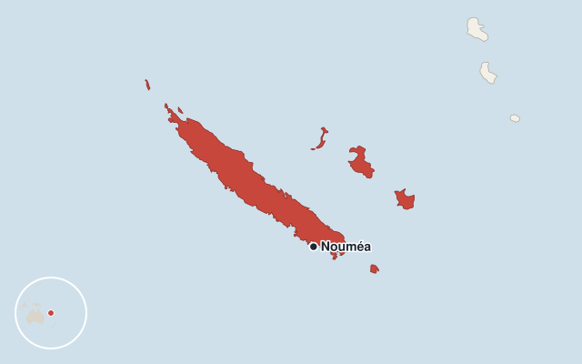

---
id    = "5e81e3b2-3c21-5f5f-87ae-c7b3b5d70894"
model = "Basic"
tags  = ["oceania", "country"]
---

## Front

<b>Nouméa</b> is the capital of which country or territory?

## Back

<b>New Caledonia</b>

## Extra

About 264,600 people (April 2025 census) 18,575 km² of land

Grande Terre is nicknamed le Caillou, the Pebble, a name also used for the whole territory. The indigenous Kanak people make up 41% of the population.

Overseas territory of France.

<a href="https://en.wikipedia.org/wiki/New_Caledonia">New Caledonia on Wikipedia</a> <a href="https://en.wikipedia.org/wiki/Noum%C3%A9a">Nouméa on Wikipedia</a>
