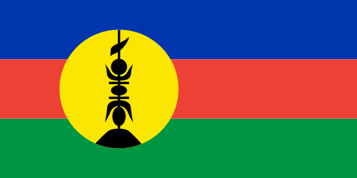
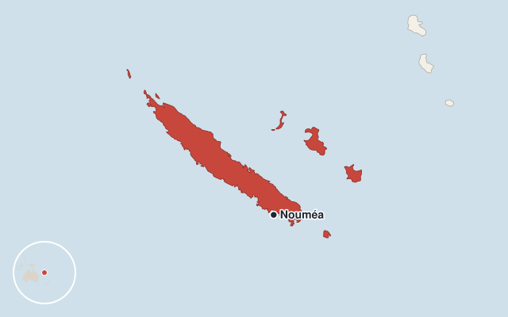

---
id    = "cb730201-ed92-596c-9dd4-b26e6c1ece1f"
model = "Basic"
tags  = ["oceania", "flag"]
---

## Front

Whose flag is this?

## Back

<b>New Caledonia</b>

## Extra

Overseas territory of France.

<a href="https://en.wikipedia.org/wiki/Flag_of_France">Flag of France on Wikipedia</a> <a href="https://en.wikipedia.org/wiki/New_Caledonia">New Caledonia on Wikipedia</a>
