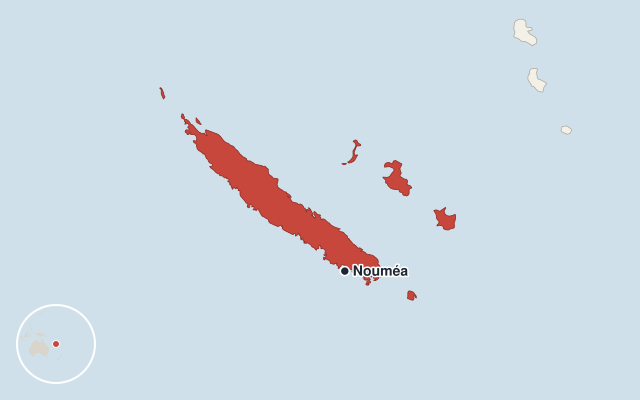
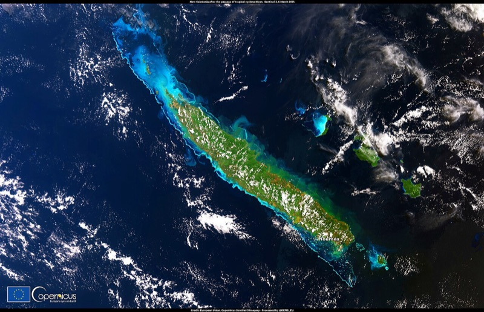

---
id    = "ab727bcd-cd48-50af-9954-31a472eab445"
model = "Basic"
tags  = ["oceania", "map"]
---

## Front

What is highlighted on this map?

## Back

<b>New Caledonia</b>

## Extra

<i>Photo: Contains modified Copernicus Sentinel data 2020, European Union, Copernicus Sentinel-3 imagery, via Wikimedia Commons</i>

Main island Grande Terre, plus the Loyalty Islands and the Isle of Pines

The territory lies 1,210 km east of Australia and 220 km southwest of Vanuatu. The four inhabited Loyalty Islands off the east coast are Ouvéa, Lifou, Tiga and Maré.

Overseas territory of France.

<a href="https://en.wikipedia.org/wiki/New_Caledonia">New Caledonia on Wikipedia</a>
