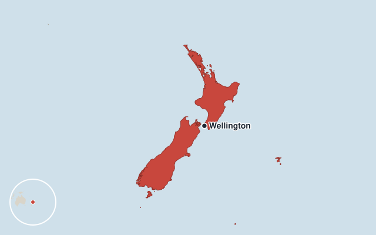

---
id    = "7228791e-3d25-50c9-a245-8a375bee9b1c"
model = "Basic"
tags  = ["oceania", "sovereign_state", "capital"]
---

## Front

What is the capital of <b>New Zealand</b>?

## Back

<b>Wellington</b>

## Extra

About 216,000 people (2023) At the southwestern tip of the North Island, between Cook Strait and the Remutaka Range

Named in 1840 after the first Duke of Wellington, victor of Waterloo. The capital since 1865, it is the world's southernmost capital of a sovereign state.

<a href="https://en.wikipedia.org/wiki/Wellington">Wellington on Wikipedia</a> <a href="https://en.wikipedia.org/wiki/New_Zealand">New Zealand on Wikipedia</a>
