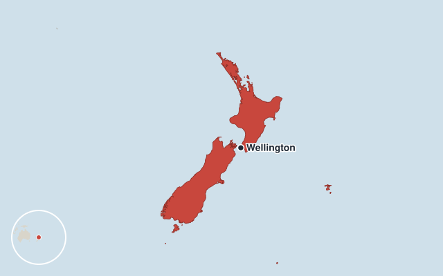

---
id    = "f9a65f1f-c47d-5b1e-b34d-6aecb64a3b2f"
model = "Basic"
tags  = ["oceania", "sovereign_state", "country"]
---

## Front

<b>Wellington</b> is the capital of which country or territory?

## Back

<b>New Zealand</b>

## Extra

<a href="https://en.wikipedia.org/wiki/New_Zealand">New Zealand on Wikipedia</a> <a href="https://en.wikipedia.org/wiki/Wellington">Wellington on Wikipedia</a>
