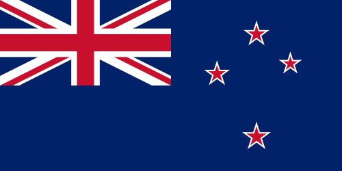

---
id    = "ba570f85-a812-5130-bfe9-13f975fc4817"
model = "Basic"
tags  = ["oceania", "sovereign_state", "flag"]
---

## Front

Whose flag is this?

## Back

<b>New Zealand</b>

## Extra

Similar flags: Australia (white stars, two more stars)
