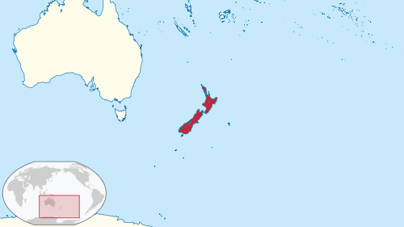
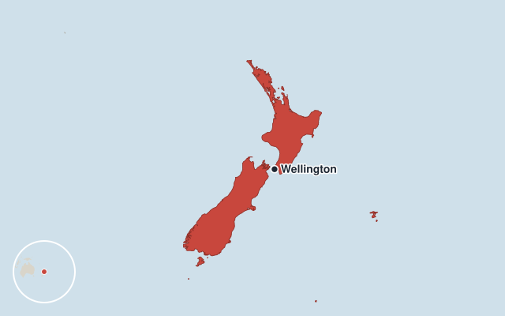

---
id    = "33c9be29-dbaf-58ca-9657-d515988986d4"
model = "Basic"
tags  = ["oceania", "sovereign_state", "map"]
---

## Front

What is highlighted on this map?

## Back

<b>New Zealand</b>

## Extra

<a href="https://en.wikipedia.org/wiki/New_Zealand">New Zealand on Wikipedia</a>
