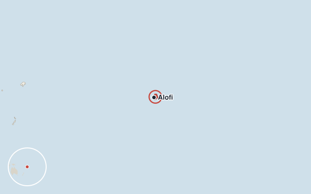
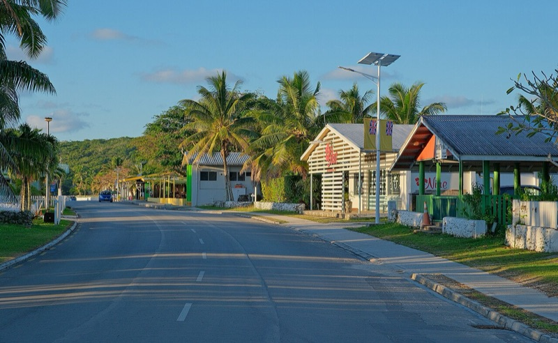

---
id    = "cd5f45a6-cb77-562c-850c-4e79129faecc"
model = "Basic"
tags  = ["oceania", "sovereign_state", "capital"]
---

## Front

What is the capital of <b>Niue</b>?

## Back

<b>Alofi</b>

## Extra

<i>Photo: Pseudopanax at English Wikipedia, Public domain, via Wikimedia Commons</i>

About 575 people (2025) On Alofi Bay, on the west coast

The second-smallest national capital by population. After Cyclone Heta in 2004 wrecked many buildings, including the hospital, government offices moved about 3 km inland.

<a href="https://en.wikipedia.org/wiki/Alofi">Alofi on Wikipedia</a> <a href="https://en.wikipedia.org/wiki/Niue">Niue on Wikipedia</a>
