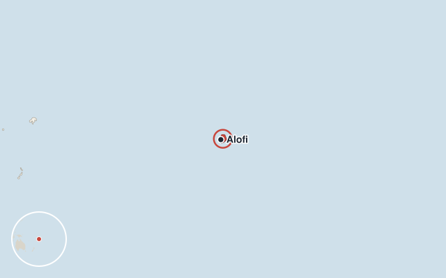

---
id    = "e98f198e-7293-5ad2-91ca-2d0e9697c4fa"
model = "Basic"
tags  = ["oceania", "sovereign_state", "country"]
---

## Front

<b>Alofi</b> is the capital of which country or territory?

## Back

<b>Niue</b>

## Extra

<a href="https://en.wikipedia.org/wiki/Niue">Niue on Wikipedia</a> <a href="https://en.wikipedia.org/wiki/Alofi">Alofi on Wikipedia</a>
