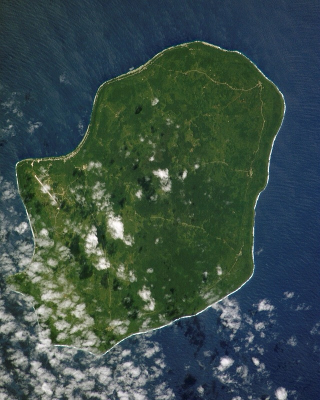

---
id    = "d54be692-e079-512b-8b9b-1a51f1f784b8"
model = "Basic"
tags  = ["oceania", "sovereign_state", "map"]
---

## Front

What is highlighted on this map?

## Back

<b>Niue</b>

## Extra

<i>Photo: NASA, Public domain, via Wikimedia Commons</i>

About 260 km² 2,400 km northeast of New Zealand

A raised coral island with two levels: a limestone cliff along the coast with a central plateau about 60 m up, and a lower coastal terrace. A reef circles it, broken only near Alofi.

<a href="https://en.wikipedia.org/wiki/Niue">Niue on Wikipedia</a>
