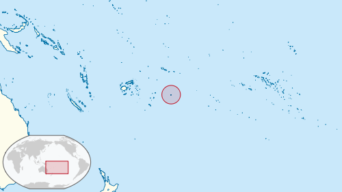
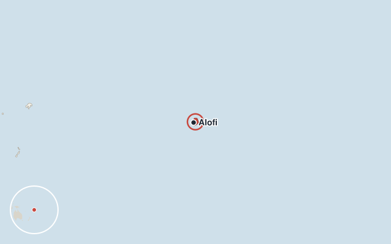

---
id    = "d54be692-e079-512b-8b9b-1a51f1f784b8"
model = "Basic"
tags  = ["oceania", "sovereign_state", "map"]
---

## Front

What is highlighted on this map?

## Back

<b>Niue</b>

## Extra

<a href="https://en.wikipedia.org/wiki/Niue">Niue on Wikipedia</a>
