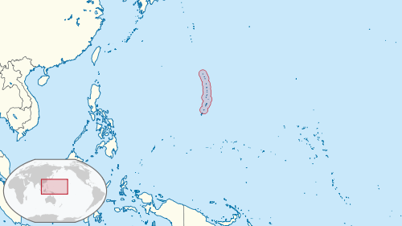

---
id    = "5c85d319-fe90-5f6e-aeb0-9db8b4b4dc07"
model = "Basic"
tags  = ["oceania", "map"]
---

## Front

What is highlighted on this map?

## Back

<b>Northern Mariana Islands</b>

## Extra

Unincorporated territory of the United States.

<a href="https://en.wikipedia.org/wiki/Northern_Mariana_Islands">Northern Mariana Islands on Wikipedia</a>
