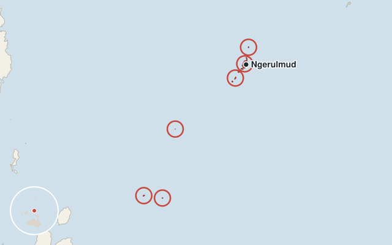

---
id    = "8f9c0b95-e76f-5c0b-875f-0e1298e4c039"
model = "Basic"
tags  = ["oceania", "sovereign_state", "capital"]
---

## Front

What is the capital of <b>Palau</b>?

## Back

<b>Ngerulmud</b>

## Extra

<a href="https://en.wikipedia.org/wiki/Ngerulmud">Ngerulmud on Wikipedia</a> <a href="https://en.wikipedia.org/wiki/Palau">Palau on Wikipedia</a>
