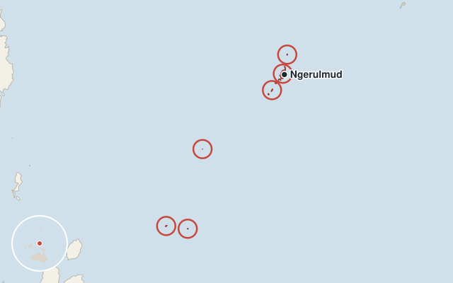

---
id    = "34fe8036-58b8-5aa2-9bcf-dc72036724e0"
model = "Basic"
tags  = ["oceania", "sovereign_state", "country"]
---

## Front

<b>Ngerulmud</b> is the capital of which country or territory?

## Back

<b>Palau</b>

## Extra

About 21,700 people (2017) on 466 km² About 340 islands

The sixteenth-smallest country in the world, and the western part of the Caroline Islands.

<a href="https://en.wikipedia.org/wiki/Palau">Palau on Wikipedia</a> <a href="https://en.wikipedia.org/wiki/Ngerulmud">Ngerulmud on Wikipedia</a>
