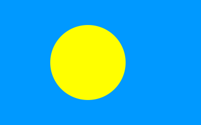
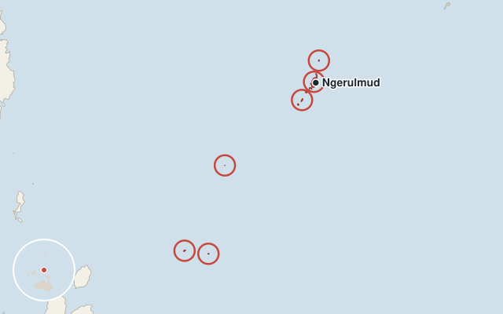

---
id    = "6c13f921-7541-5ca4-a13c-6c792f03735f"
model = "Basic"
tags  = ["oceania", "sovereign_state", "flag"]
---

## Front

Whose flag is this?

## Back

<b>Palau</b>

## Extra

Adopted on 1 January 1981, when Palau separated from the UN Trust Territory

Light blue for the Pacific and the move from foreign rule to self-government. The golden disc, slightly off-centre, is the full moon, which Palauans see as the best time for human activity.

<a href="https://en.wikipedia.org/wiki/Flag_of_Palau">Flag of Palau on Wikipedia</a> <a href="https://en.wikipedia.org/wiki/Palau">Palau on Wikipedia</a>
