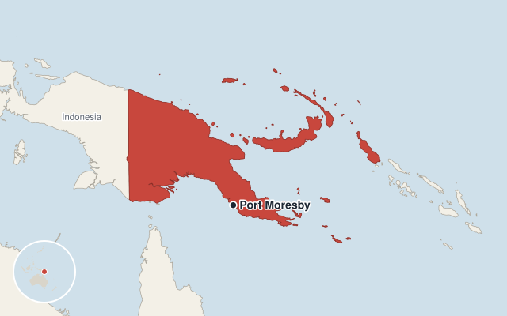

---
id    = "fc8e0c89-5026-59c5-b897-dc332ead1b57"
model = "Basic"
tags  = ["oceania", "sovereign_state", "capital"]
---

## Front

What is the capital of <b>Papua New Guinea</b>?

## Back

<b>Port Moresby</b>

## Extra

About 757,000 people (2024 census) On the Coral Sea coast of the Papuan Peninsula

Named for Captain John Moresby, the first Briton to see it, in 1873, in honour of his father, Admiral of the Fleet Sir Fairfax Moresby. It is not part of the province around it.

<a href="https://en.wikipedia.org/wiki/Port_Moresby">Port Moresby on Wikipedia</a> <a href="https://en.wikipedia.org/wiki/Papua_New_Guinea">Papua New Guinea on Wikipedia</a>
