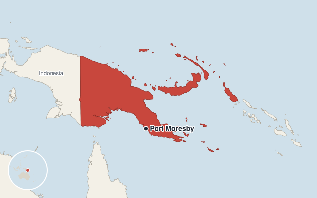

---
id    = "95169d92-dc50-55a2-a93f-4a0e223d3cdf"
model = "Basic"
tags  = ["oceania", "sovereign_state", "country"]
---

## Front

<b>Port Moresby</b> is the capital of which country or territory?

## Back

<b>Papua New Guinea</b>

## Extra

<a href="https://en.wikipedia.org/wiki/Papua_New_Guinea">Papua New Guinea on Wikipedia</a> <a href="https://en.wikipedia.org/wiki/Port_Moresby">Port Moresby on Wikipedia</a>
