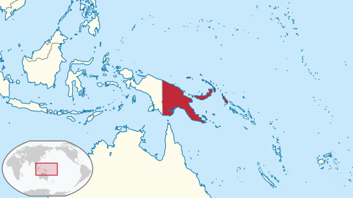
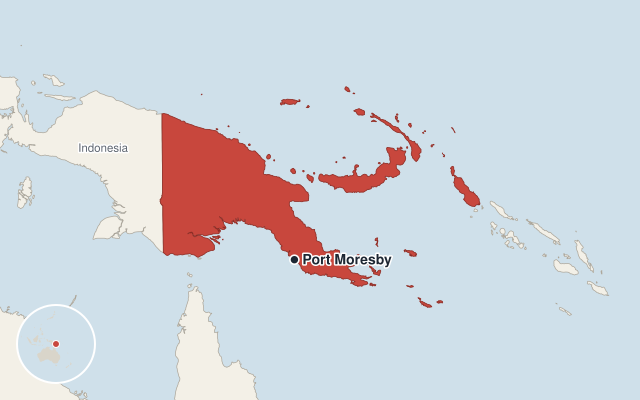

---
id    = "5e8745fa-30fe-5c8d-ad96-5cabeb4de437"
model = "Basic"
tags  = ["oceania", "sovereign_state", "map"]
---

## Front

What is highlighted on this map?

## Back

<b>Papua New Guinea</b>

## Extra

<a href="https://en.wikipedia.org/wiki/Papua_New_Guinea">Papua New Guinea on Wikipedia</a>
