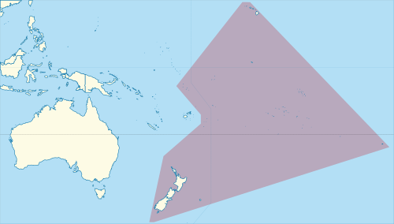

---
id    = "5deee3bd-f569-59c4-aa1c-786abb9664aa"
model = "Basic"
tags  = ["oceania", "map"]
---

## Front

What is highlighted on this map?

## Back

<b>Polynesia</b>

## Extra

Subregion of Oceania comprising thousands of small islands in the central and southern Pacific Ocean.

<a href="https://en.wikipedia.org/wiki/Polynesia">Polynesia on Wikipedia</a>
