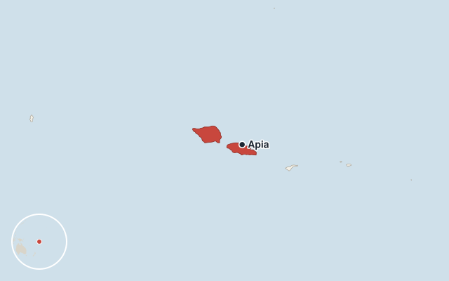

---
id    = "fe21a694-a343-57ee-b95e-f4c8744bc66e"
model = "Basic"
tags  = ["oceania", "sovereign_state", "capital"]
---

## Front

What is the capital of <b>Samoa</b>?

## Back

<b>Apia</b>

## Extra

About 36,000 people in the urban area (2021 census) On the central north coast of Upolu, 2 m above sea level

Grew from a small village that had 304 people in 1800. The modern city was founded in the 1850s and has been the official capital since 1959.

<a href="https://en.wikipedia.org/wiki/Apia">Apia on Wikipedia</a> <a href="https://en.wikipedia.org/wiki/Samoa">Samoa on Wikipedia</a>
