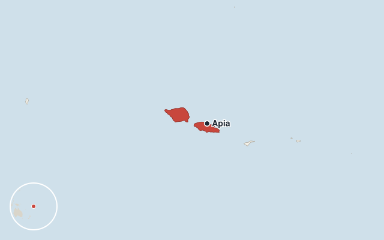

---
id    = "0cb22bc7-2d1a-5061-909e-1fc20ac5518e"
model = "Basic"
tags  = ["oceania", "sovereign_state", "country"]
---

## Front

<b>Apia</b> is the capital of which country or territory?

## Back

<b>Samoa</b>

## Extra

About 200,000 people (2021) on 2,842 km² 64 km west of American Samoa

Before the 20th century, European explorers called the whole island group the Navigator Islands, because of the Samoans' seafaring skills.

<a href="https://en.wikipedia.org/wiki/Samoa">Samoa on Wikipedia</a> <a href="https://en.wikipedia.org/wiki/Apia">Apia on Wikipedia</a>
