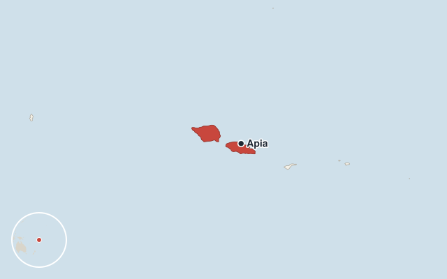

---
id    = "dcf675bc-32ff-5b96-9715-8e59e331b1ed"
model = "Basic"
tags  = ["oceania", "sovereign_state", "flag"]
---

## Front

Whose flag is this?

## Back

<b>Samoa</b>

## Extra

Designed in 1948 with four stars; the fifth was added in 1949

A red field with a blue canton holding five white stars in the shape of the Southern Cross. Paramount chiefs Malietoa Tanumafili II and Tupua Tamasese Meaʻole designed it.

<a href="https://en.wikipedia.org/wiki/Flag_of_Samoa">Flag of Samoa on Wikipedia</a> <a href="https://en.wikipedia.org/wiki/Samoa">Samoa on Wikipedia</a>
