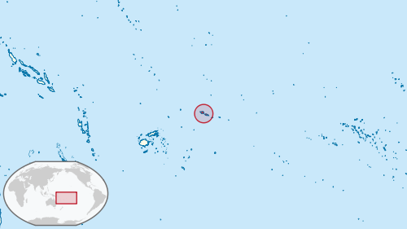
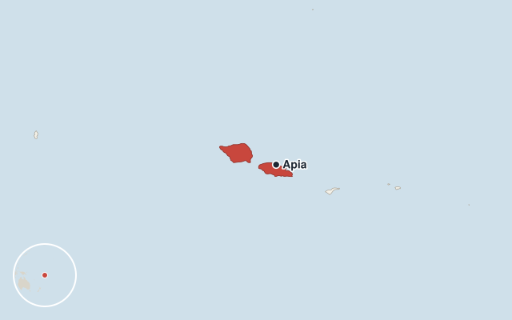
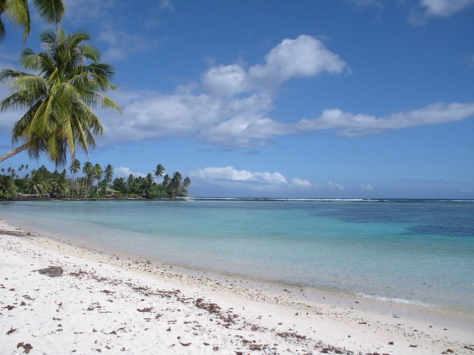

---
id    = "a3a0982b-7067-50e2-86b0-c31e723d76ec"
model = "Basic"
tags  = ["oceania", "sovereign_state", "map"]
---

## Front

What is highlighted on this map?

## Back

<b>Samoa</b>

## Extra

<i>Photo: Stephen Glauser, CC BY-SA 2.0, via Wikimedia Commons</i>

Two main islands, Savaiʻi and Upolu Two smaller inhabited islands, Manono and Apolima

The archipelago has seen volcanic hotspot activity for the past 2 million years. Several smaller uninhabited islands, including the Aleipata Islands, lie off Upolu.

<a href="https://en.wikipedia.org/wiki/Samoa">Samoa on Wikipedia</a>
