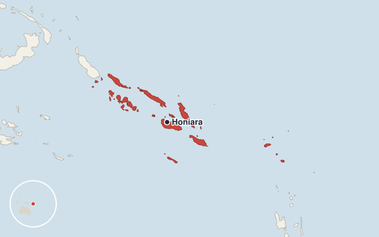
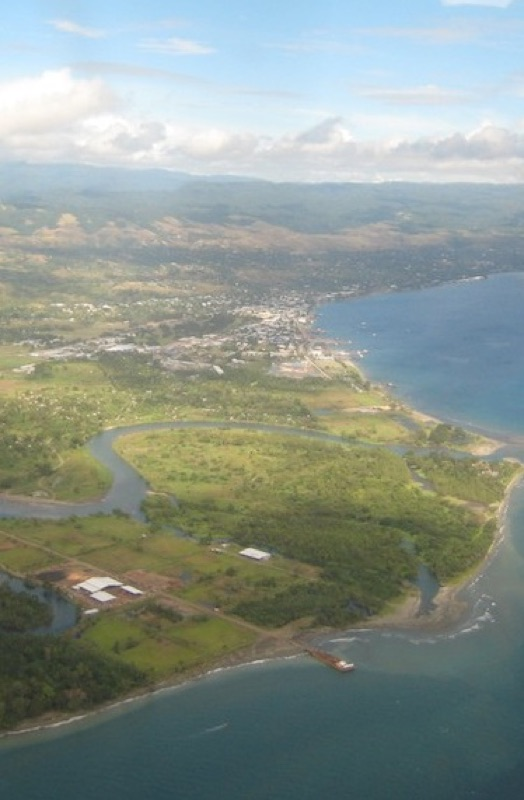

---
id    = "a1517a8c-b395-595e-96d2-0fe5df45254c"
model = "Basic"
tags  = ["oceania", "sovereign_state", "capital"]
---

## Front

What is the capital of <b>Solomon Islands</b>?

## Back

<b>Honiara</b>

## Extra

<i>Photo: Xploredive cropped by Dr. Blofeld, CC BY 2.0, via Wikimedia Commons</i>

About 130,000 people (2019) On the northwestern coast of Guadalcanal

The name comes from nagho ni ara in a Guadalcanal language, roughly "place of the east wind". It became the administrative centre of the British protectorate in 1952.

<a href="https://en.wikipedia.org/wiki/Honiara">Honiara on Wikipedia</a> <a href="https://en.wikipedia.org/wiki/Solomon_Islands">Solomon Islands on Wikipedia</a>
