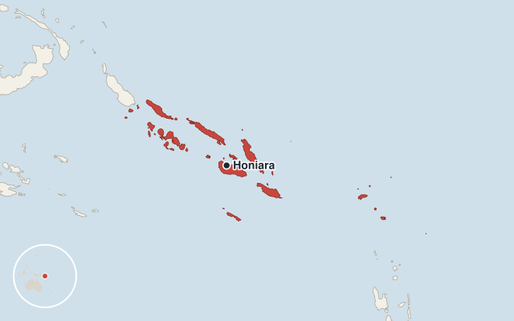

---
id    = "77057188-3d45-5b98-83b8-60f95828a5dc"
model = "Basic"
tags  = ["oceania", "sovereign_state", "country"]
---

## Front

<b>Honiara</b> is the capital of which country or territory?

## Back

<b>Solomon Islands</b>

## Extra

<a href="https://en.wikipedia.org/wiki/Solomon_Islands">Solomon Islands on Wikipedia</a> <a href="https://en.wikipedia.org/wiki/Honiara">Honiara on Wikipedia</a>
