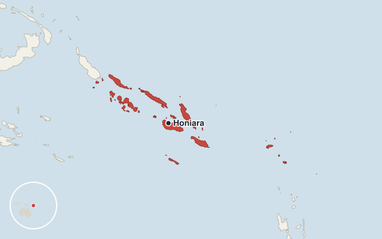

---
id    = "96324d91-3800-59d2-9069-168a5c2ec72a"
model = "Basic"
tags  = ["oceania", "sovereign_state", "flag"]
---

## Front

Whose flag is this?

## Back

<b>Solomon Islands</b>

## Extra

<a href="https://en.wikipedia.org/wiki/Flag_of_Solomon_Islands">Flag of Solomon Islands on Wikipedia</a> <a href="https://en.wikipedia.org/wiki/Solomon_Islands">Solomon Islands on Wikipedia</a>
