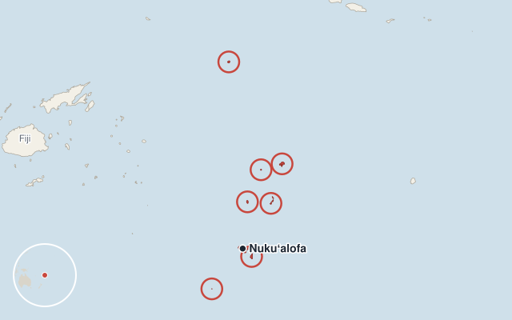

---
id    = "bf5ee7de-5b72-5820-837a-2e26148740fa"
model = "Basic"
tags  = ["oceania", "sovereign_state", "capital"]
---

## Front

What is the capital of <b>Tonga</b>?

## Back

<b>Nukuʻalofa</b>

## Extra

About 23,000 people (2016) On the north coast of Tongatapu

The world's westernmost capital of a sovereign state, despite lying in the southernmost island group of Tonga.

<a href="https://en.wikipedia.org/wiki/Nuku%CA%BBalofa">Nukuʻalofa on Wikipedia</a> <a href="https://en.wikipedia.org/wiki/Tonga">Tonga on Wikipedia</a>
