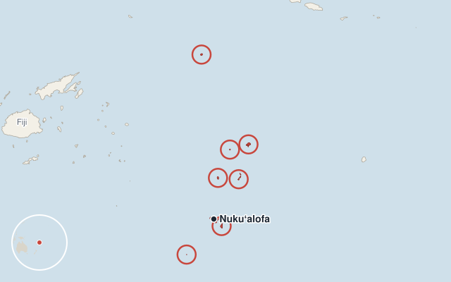

---
id    = "4cc75299-3004-5aa6-a02d-ccf511f795f3"
model = "Basic"
tags  = ["oceania", "sovereign_state", "country"]
---

## Front

<b>Nukuʻalofa</b> is the capital of which country or territory?

## Back

<b>Tonga</b>

## Extra

About 105,700 people (2020) on about 750 km² 171 islands, 45 of them inhabited

Under British protection from 1900 to 1970, it remained the only Pacific nation to keep its monarchical government.

<a href="https://en.wikipedia.org/wiki/Tonga">Tonga on Wikipedia</a> <a href="https://en.wikipedia.org/wiki/Nuku%CA%BBalofa">Nukuʻalofa on Wikipedia</a>
