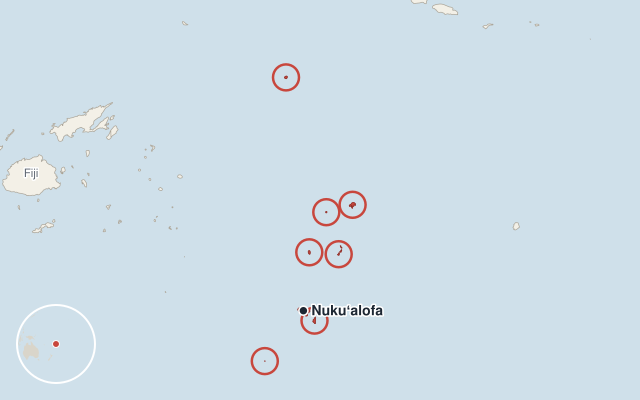

---
id    = "7308e020-bbe1-518d-9cc0-222dc6fae4bb"
model = "Basic"
tags  = ["oceania", "sovereign_state", "flag"]
---

## Front

Whose flag is this?

## Back

<b>Tonga</b>

## Extra

<a href="https://en.wikipedia.org/wiki/Flag_of_Tonga">Flag of Tonga on Wikipedia</a> <a href="https://en.wikipedia.org/wiki/Tonga">Tonga on Wikipedia</a>
