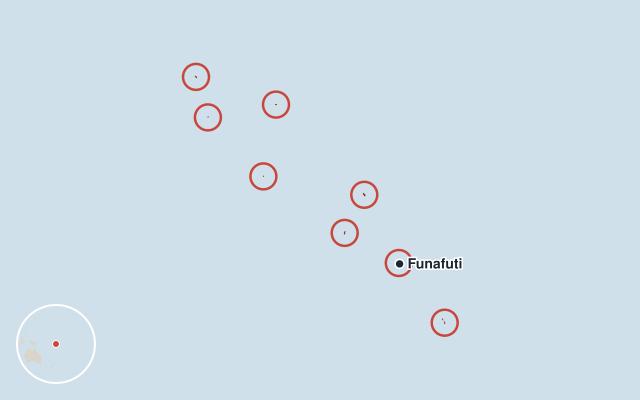

---
id    = "b30c962c-e48c-51fb-be8e-bc85685f1a1a"
model = "Basic"
tags  = ["oceania", "sovereign_state", "capital"]
---

## Front

What is the capital of <b>Tuvalu</b>?

## Back

<b>Funafuti</b>

## Extra

<a href="https://en.wikipedia.org/wiki/Funafuti">Funafuti on Wikipedia</a> <a href="https://en.wikipedia.org/wiki/Tuvalu">Tuvalu on Wikipedia</a>
