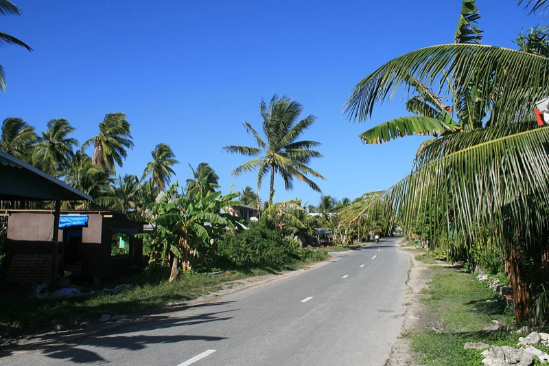

---
id    = "b30c962c-e48c-51fb-be8e-bc85685f1a1a"
model = "Basic"
tags  = ["oceania", "sovereign_state", "capital"]
---

## Front

What is the capital of <b>Tuvalu</b>?

## Back

<b>Funafuti</b>

## Extra

<i>Photo: Davidarfonjones, CC BY-SA 3.0, via Wikimedia Commons</i>

About 6,320 people (2017 census), roughly 60% of the nation A narrow ring of land, 20 to 400 m wide, around a lagoon 18 km long

An American sea captain named it Ellice's Island in 1819, after an English politician. In World War II the Americans dredged its lagoon harbour and built the airfield.

<a href="https://en.wikipedia.org/wiki/Funafuti">Funafuti on Wikipedia</a> <a href="https://en.wikipedia.org/wiki/Tuvalu">Tuvalu on Wikipedia</a>
